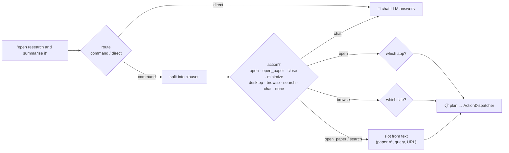

# Decision models (routing & planning without generating text)

> How AndreOS uses a small *decision model* to route requests and plan OS
> actions in the browser, while the chat LLM only writes answers.
> Why we chose this: [ADR 0001](../adr/0001-decision-model-planner.md).

---

## 1. The idea

A chat LLM *generates* — to route or plan it has to write `command` or a JSON
array, from a long few-shot prompt. A **decision model** *chooses*: it reads a
context plus a question with candidate options and returns a probability for each
option ([System One](https://huggingface.co/vllm-sr) format). Routing and planning
are exactly that shape, so the assistant asks a few small questions instead:



The model only **picks**; values it can't pick (a URL, a paper number, a search
query) come from the request text, and `chat` steps go to the chat LLM unchanged.
The output is the same action schema the LLM planner produces, so execution, the
plan checklist UI and the evals don't care which planner made it.

---

## 2. Where it lives

| Piece | File | Role |
|---|---|---|
| Router + planner | [`decisionPlanner.js`](../../src/js/assistant/engine/decisionPlanner.js) | `routeWithDecisions`, `planWithDecisions` — the questions, option descriptions and slot filling |
| Browser engine | [`vela.js`](../../src/js/assistant/engine/vela.js) | `loadVela({ baseUrl }).decide(state, questions)` — render, tokenise, ONNX forward, softmax |
| LLM planner (alternative) | [`llmPlanner.js`](../../src/js/assistant/engine/llmPlanner.js) | the chat model's router/planner prompts, shared with the CLI experiment |
| Wiring | [`chat.js`](../../src/js/assistant/engine/chat.js) | `routeIntent` / `parseCommand` use the decision model when Settings → Command planner = *Decision model*; fall back to the chat model on failure |
| Setting | [`Settings.js`](../../src/js/platform/services/Settings.js) | `getPlanner()`, `DECISION_MODEL`, `getPlannerModelId()` |
| UI source tags | [`VoiceCommandManager.js`](../../src/js/assistant/voice/VoiceCommandManager.js) | ⚡ *Quick action* (rules / decision model) vs 🧠 *Planned / Answered by the AI* |

The state the model sees is `Focused window: <app>\nVisitor said: "<clause>"`.
Option descriptions use example phrases that are **not** in the eval sets, so the
scores measure generalisation.

---

## 3. Running it in the browser

`vela.js` is a JS port of the source package's decision path (renderer
`render31` + the readout heads), on [onnxruntime-web](https://onnxruntime.ai/docs/tutorials/web/):

```text
[BOS] [Q] instructions ([O] name[: description])* [SEP_SCHEMA] [SEG_user] state [EOS]
        → encoder + readout heads (one ONNX graph) → logits per [O] → softmax
```

- **Device:** WebGPU when the browser has it, else WASM (CPU). A failed WebGPU
  session falls back to WASM.
- **Caching:** model files go through the Cache API, so they download once.
- **WASM runtime:** loaded from jsDelivr (pinned to the installed version) — the
  bundled `.wasm` is 29 MB, over Cloudflare Pages' 25 MiB file limit.
- **Lazy:** nothing is downloaded until the decision model is selected and the
  first request is routed.

---

## 4. The models we ship

Hosted at [huggingface.co/andreped/vela3.1-onnx](https://huggingface.co/andreped/vela3.1-onnx),
one folder per variant (`pico-150m/` is used; `pico-380m/` is there for comparison).
Each folder: `config.json` (marker ids + which file per device), tokenizer,
`parity.json` (reference answers from the PyTorch package) and:

| File | Device | Size (150m) | Precision |
|---|---|---|---|
| `onnx/model_fp16w.onnx` | WebGPU | ~305 MB | weights stored fp16, cast to fp32 at load → fp32 math (exact) |
| `onnx/model_quantized.onnx` | WASM | ~210 MB | dynamic int8; RoPE, attention, MLP down-projections and heads kept fp32 |

Produced by [`scripts/export_vela_web.py`](../../scripts/export_vela_web.py) (Python
is only used for this one-off conversion). Lessons baked into the export:

- **Full fp16 compute is wrong on WebGPU** (flips decisions, max |Δp| 0.8) though the
  same file is fine on CPU → ship fp16-*stored* weights with fp32 math instead.
- **Naive int8 flips decisions** → keep the outlier-sensitive layers (MLP
  down-projections, attention, RoPE) and the readout (cosine / τ amplifies error)
  in fp32.
- The state is mean-pooled directly (not via a cumulative-sum difference) and the
  readout rows are kept 2-D, which keeps the graph numerically and shape-wise
  friendly to every backend.

Check a local export against PyTorch: `node tests/evals/vela.selfcheck.mjs [model dir]`
(token ids must match exactly; probabilities within tolerance).

---

## 5. Performance (indicative)

Apple M4 Pro, Chrome; score · median time per call. Small eval sets (28 / 14 / 9).

| Planner | Where | Routing | Commands | Plans |
|---|---|---|---|---|
| pico-150m | WebGPU | 100% · 36 ms | 93% · 105 ms | 78% · 90 ms |
| pico-150m | WASM (CPU) | 100% · 250 ms | 93% · 753 ms | 67% · 724 ms |
| Qwen3.5 2B prompted | WebGPU (WebLLM) | 96% · 614 ms | 100% · 2.6 s | 100% · 2.7 s |

Decisions run *before* an answer is written, so the decision model and the chat
model never compete for the device within a turn. Full numbers and other models
tried: [ADR 0001](../adr/0001-decision-model-planner.md).

---

## 6. Evaluating planners

Routing / commands / plan can be scored for any planner, and every run records
**which model** produced each suite and the **median time per call**
([evals architecture](./assistant-evals-architecture.md)):

```bash
# decision model, in-process with the browser engine (CPU)
VELA_DIR=models/vela3.1-onnx/pico-150m node tests/evals/decisionPlanner.experiment.mjs
# the chat model's prompts on a local Ollama model (add LLM_CPU=1 for CPU only)
LLM_MODEL=qwen3.5:2b node tests/evals/decisionPlanner.experiment.mjs
```

Both use [`harness/plannerSuites.js`](../../tests/evals/harness/plannerSuites.js),
which also runs in the browser (WebGPU runs are posted to the dev-only
`/__evals/experiment` endpoint). Runs land in `tests/evals/results/experiments.json`
and show in the Evals app's **Experiments** tab.

---

## 7. Limits

- Request splitting and slot filling use **English-only** text patterns: Norwegian
  routing works, Norwegian multi-step plans don't yet.
- The planner sees the **focused window**, not the conversation history.
- Decision models are sensitive to **option wording** (pico-380m drops from 100 % to
  57 % on commands with one wording change) — grow the eval set before tuning.
- First use downloads ~210–305 MB (cached afterwards); on WebGPU the weights take
  ~600 MB of GPU memory next to the chat model.
