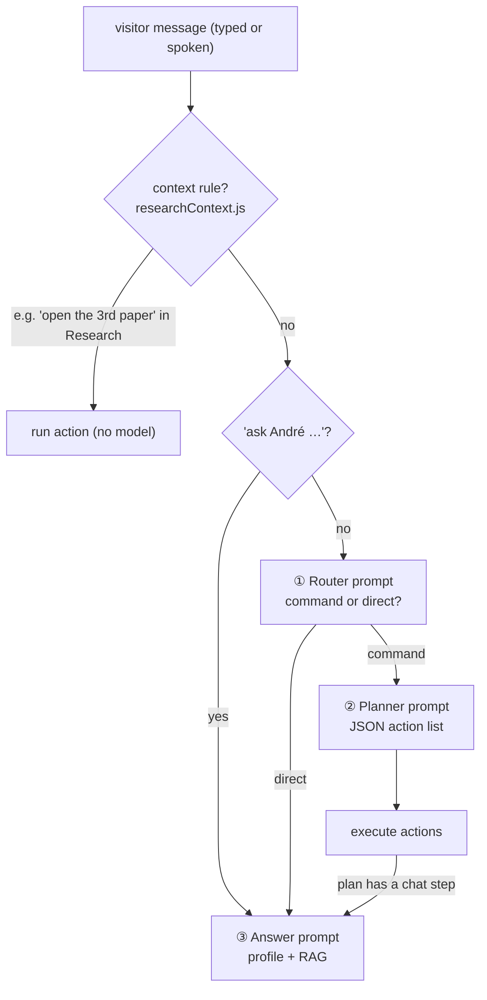

# How the assistant prompts its models

Every assistant turn can make up to three model calls, each with its own prompt.
This doc maps them, explains how language is handled, and lists the rules for
changing a prompt.

## 1. The turn, end to end



The order lives in `_routeTranscript()` in
[VoiceCommandManager.js](../../src/js/assistant/voice/VoiceCommandManager.js).
Rules that need UI state (which paper is listed third) run first, without a model.
On the CPU backend, plainly conversational text skips ① and ② to keep the KV cache warm.

## 2. The prompts

| # | Task | Built in | Called from | Output | Generation |
|---|---|---|---|---|---|
| ① | Router | `routerPrompt()` in [llmPlanner.js](../../src/js/assistant/engine/llmPlanner.js) | `routeIntent()` in [chat.js](../../src/js/assistant/engine/chat.js) | `command` / `direct` | `ROUTER_GEN`: 8 tokens, temp 0, no thinking |
| ② | Planner | `plannerPrompt()` in llmPlanner.js | `parseCommand()` in chat.js | JSON array of actions | `PLANNER_GEN`: 150 tokens, temp 0.1, no thinking |
| ③ | Answer | `buildProfileContext()` in [andre-profile.js](../../src/js/assistant/engine/andre-profile.js) + RAG in chat.js | `sendMessage()`, `querySidebar()`, `answer()` | free text | 512 tokens (more with reasoning), temp 0.7 |

**Router and planner** are single `user` messages: instructions, rules, few-shot
examples, recent history (4 turns for the router, 6 for the planner), then the
message. They never carry the bio, so they stay short. The output contract is
fixed: the router answers `command`/`direct`, and the planner emits the action
schema (`open`, `open_paper`, `close`, `minimize`, `desktop`, `browse`, `search`, `chat`)
with English app ids. `parseRoute()` and `parsePlan()` read that contract, and a
malformed plan counts as no plan.

**Answer** is a `system` message with three parts:
- the **core**: rules and identity, always sent first so it stays a cache-warm prefix;
- the **profile sections** BM25 picks for the question (top 3);
- **context**: the viewed paper, or research-paper RAG when the question is about
  research. A viewed paper replaces the general RAG.

Then the conversation follows. Why the bio is retrieved instead of sent whole:
[prompt-compression.md](./prompt-compression.md).

**Decision-model planner (alternative).** With Settings → Command planner = decision model,
① and ② are not prompts. [decisionPlanner.js](../../src/js/assistant/engine/decisionPlanner.js)
asks the model to pick among described options (`ROUTE`, `ACTIONS`, app and site options),
and slots come from the text. See [decision-models.md](./decision-models.md).

## 3. Language

Two independent mechanisms:

| What | How the language is chosen | Where |
|---|---|---|
| Router + planner **prompt** | per message: `promptLanguage(text)` → `en` or `no` (default `auto`) | llmPlanner.js |
| Answer **reply language** | Settings → LLM language: `no` / `en` append "Always respond in …"; `auto` adds nothing, so the model mirrors the visitor | chat.js |

The router and the planner each have an English and a Norwegian prompt (`ROUTER.en/no`,
`PLANNER.en/no`). Only the wording, rules and examples change. The output contract
stays English, so parsing is the same for both. The Norwegian planner adds one rule
mapping Norwegian app names to ids (forskning → research, CV → resume, …).

The prompt follows the **message**, not the setting, because a mismatch costs
points in both directions. With `qwen3.5:2b`, Norwegian input on the English prompt
scored 50% exact on commands and 22% on plans, versus 93% / 56% on the Norwegian
prompt. A Norwegian prompt on English input lost 11 points on routing and plans.
Full numbers: [ADR 0003](../adr/0003-language-matched-planner-prompts.md).

`promptLanguage()` is a keyword check (æ/ø/å or common Norwegian words). It
picked the right language for every routing, command and plan input in both
eval sets. It misses Norwegian with none of those words (bare nouns like "forskning").

The answer prompt (profile, rules) is English for both languages. The model replies
in Norwegian when asked to. The profile and paper retrieval are English BM25, so
Norwegian questions retrieve worse (retrieval hit@3: 40% for Norwegian vs 100% for English).

## 4. Changing a prompt

- **Change both languages together.** A rule or example added to `ROUTER.en`
  / `PLANNER.en` belongs in `.no` too, and the reverse.
- **Keep the English prompts stable unless you mean to change them.** Their scores
  are the baseline for every earlier run.
- **Don't copy eval cases into examples.** Tune on the dev set
  ([plannerDev.js](../../tests/evals/datasets/plannerDev.js)), then report the test sets.
  Some current examples already overlap with the test sets, so absolute scores are optimistic.
- **Benchmark both input languages.** Each run records `evalLang` and `promptLang`
  in its config key ([evals §6c](./assistant-evals-architecture.md)):

```bash
LLM_MODEL=qwen3.5:2b node tests/evals/decisionPlanner.experiment.mjs               # en inputs, auto prompt
LLM_MODEL=qwen3.5:2b EVAL_LANG=no node tests/evals/decisionPlanner.experiment.mjs  # no inputs, auto prompt
LLM_MODEL=qwen3.5:2b EVAL_LANG=no PROMPT_LANG=en node tests/evals/decisionPlanner.experiment.mjs  # force a prompt
```

- **See the exact prompt.** Every model call is logged with its size in `vite dev`.
  In a production build, enable it from the console:
  `localStorage.setItem('andreos:debug-prompts', '1')`.

## 5. Known limits

- The answer prompt and its retrieval are English-only (see §3).
- The decision-model planner uses English option text and English-only slot filling.
- The answers eval set is not translated, so Norwegian answer quality is unmeasured.
