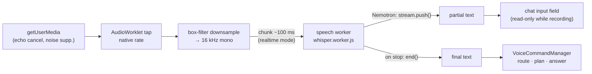

# Speech transcription & realtime streaming

How the 🎤 turns speech into text, in the browser, with no server. Two model families share
one pipeline:

| Model | Runtime | Live text while speaking | Size | Default |
|---|---|---|---|---|
| Whisper Tiny / **Base** / Small | [@xenova/transformers](https://github.com/xenova/transformers.js) (WASM) | No — transcribes when you stop | 39–244 MB | **Base** |
| Nemotron 3.5 ASR Streaming 0.6B *(experimental)* | onnxruntime-web, our own JS decoder ([`nemotron.js`](../../src/js/assistant/voice/nemotron.js)) | **Yes** | ~790 MB (int4) | — |

Why Whisper stays the default, and what we measured: [ADR 0002](../adr/0002-streaming-speech-nemotron.md).

## Pipeline

- **Capture** ([`VoiceEngine.js`](../../src/js/assistant/voice/VoiceEngine.js)): an `AudioWorklet` (inlined as a Blob URL)
  taps raw samples from a native-rate `AudioContext` — Firefox refuses to feed a mic into a 16 kHz
  context. A box filter downsamples to 16 kHz and keeps its phase across blocks. Samples are posted
  to the worker every ~100 ms.
- **Worker protocol** ([`whisper.worker.js`](../../src/js/assistant/voice/whisper.worker.js)):
  `load` → `start {language}` → `chunk {audio}`* → `end` (or `cancel`).
  Out: `progress`, `ready`, `partial {text}` (Nemotron only), `result {text}`, `error`.
  Whisper can't stream, so the worker buffers its chunks and transcribes once on `end`.
- **UI** ([`VoiceCommandManager.js`](../../src/js/assistant/voice/VoiceCommandManager.js) →
  [`AssistantSidebar.js`](../../src/js/assistant/ui/AssistantSidebar.js) `setDraft`): each partial
  replaces the input value and scrolls to the newest words. On the final result the draft is cleared
  and the text is sent through the normal assistant pipeline.
- **Send while dictating:** clicking Send (or Enter) during recording/transcribing sends the text in the
  field, stops the mic and posts `cancel`; the worker and engine drop any late partial/result.

### Modes (Settings → Speech → Transcription Mode)

- **Realtime** *(default)* — chunks stream during recording; Nemotron shows text as you speak.
- **Full audio** — same capture, but the whole recording is sent on stop. For A/B testing:
  Nemotron's output is identical in both modes for the same audio (the self-check asserts it), so
  this compares *experience*, not accuracy.

## Nemotron in the browser

The [onnx-community int4 export](https://huggingface.co/onnx-community/nemotron-3.5-asr-streaming-0.6b-onnx-int4)
targets onnxruntime-genai, which doesn't run in the browser. [`nemotron.js`](../../src/js/assistant/voice/nemotron.js)
re-implements the two parts genai would do:

- **Front-end:** NeMo log-mel (pre-emphasis 0.97, centred STFT 512/160/400, Hann, Slaney mel ×128,
  `log(x + 2⁻²⁴)`), computed incrementally so streamed frames equal a whole-utterance pass.
- **Cache-aware streaming:** 560 ms chunks (56 mel frames + a 9-frame pre-encode cache). The encoder
  carries its attention/conv caches between chunks, so no audio is re-encoded.
- **Greedy RNN-T:** per encoder frame, run joint → argmax, emit up to 10 tokens until blank.
- **Language prompt:** NeMo `prompt_dictionary` ids — `en-US` = 0, `nb-NO` = 103, `auto` = 101.
- **Placement:** encoder on WebGPU (WASM fallback); the tiny LSTM decoder + joint on WASM, since one
  call per token beats GPU round-trips.
- **Priming:** every stream starts with 0.5 s of silence — speech in the very first chunk often decodes
  to nothing (see ADR 0002).
- **Caching:** weights live in the Cache API (`andreos-nemotron`) after the first download.

## Checks

- `node tests/evals/nemotron.selfcheck.mjs [model dir]` — English + Norwegian clips from macOS `say`,
  transcribed in one pass and in 100 ms pushes (must match), with key-word asserts. Skips without the
  local ONNX download (default `/tmp/nemo35`) or off macOS.
